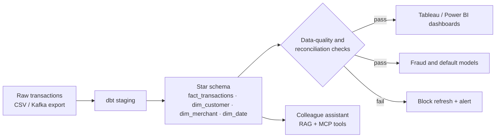

# Card Risk Analytics

Analytics, ML and an AI assistant on card transaction data: a tested SQL model, reconciled numbers, BI dashboards, a fraud model and a Claude-powered colleague assistant.

Built to mirror how bank data, BI and risk teams work: **SQL + dbt on Databricks/Snowflake, Python (pandas, scikit-learn, spaCy), Tableau / Power BI, data-quality controls, and GenAI with RAG**.

> Status: 🚧 in progress. See the [roadmap](#roadmap) and the GitHub Issues board.

## Pipeline



## Tech stack

| Area | Tools |
| --- | --- |
| Storage / compute | PostgreSQL locally → Databricks or Snowflake |
| Modeling | SQL, dbt (staging → marts, tests) |
| Python | pandas, scikit-learn, spaCy, pytest |
| BI | Tableau Public, Power BI, Excel MI pack |
| Orchestration | GitHub Actions / Airflow |
| Governance | Data dictionary, lineage, PII masking, reconciliation report |
| AI | Claude (Anthropic API / AWS Bedrock), embeddings + pgvector, MCP tools |

## Repository layout

```
data/sample/         Small synthetic dataset (committed)
data/raw/            Full datasets (git-ignored)
dbt/                 dbt project: staging and mart models + tests
src/card_analytics/  Python package: data generation, quality checks, models
tests/               pytest suite
notebooks/           Exploration and model notebooks
dashboards/          Tableau / Power BI files and screenshots
assistant/           RAG + agent colleague assistant
docs/                Data dictionary, lineage, findings memo
```

## Roadmap

- [x] **M1 — Data:** synthetic generator + public card-fraud dataset loaded into PostgreSQL
- [x] **M2 — SQL model:** dbt staging → star schema with tests (nulls, uniqueness, accepted values)
- [x] **M3 — Controls:** reconciliation report (source vs model to the cent), data dictionary, lineage
- [ ] **M4 — BI:** Tableau / Power BI dashboard (spend, active cards, delinquency, fraud rate) + Excel MI pack
- [ ] **M5 — ML:** segmentation (k-means) and fraud model (logistic regression → gradient boosting) with a model card
- [ ] **M6 — NLP:** classify complaint/dispute text with spaCy
- [ ] **M7 — AI assistant:** RAG over policy docs with citations + MCP tools over the platform APIs, with an eval set
- [ ] **M8 — Findings memo:** two pages, three recommendations with dollar impact

## Quick start

```powershell
python -m venv .venv
.venv\Scripts\activate                 # Windows  (source .venv/bin/activate on macOS/Linux)
pip install -r requirements.txt
$env:PYTHONPATH = "src"                # Windows PowerShell (export PYTHONPATH=src on macOS/Linux)

# 1. Start PostgreSQL (needs Docker Desktop)
docker compose up -d

# 2. Generate and load 50,000 synthetic transactions, then run the data-quality checks
python -m card_analytics.generate --rows 50000 --out data/raw/transactions.csv
python -m card_analytics.load --csv data/raw/transactions.csv

# No Docker? Use SQLite instead:
python -m card_analytics.load --csv data/raw/transactions.csv --db sqlite:///cardrisk.db

pytest
```

### Real bank data: Berka (PKDD'99)

Anonymized data from a real Czech bank, 1993–1998: 4,500 accounts, 5,369 clients, 682 loans, 892 cards and 1,056,320 transactions. Download it (Kaggle: "Berka dataset") into `data/raw/berka/` (git-ignored), then:

```powershell
python -m card_analytics.berka --src data/raw/berka --db sqlite:///cardrisk.db
```

The loader translates Czech codes to English (`PRIJEM` → credit, `VYDAJ` → debit), converts `YYMMDD` dates, derives client gender and birth date from the birth number, flags defaulted loans, and runs 26 integrity checks: row counts, unique keys, foreign keys and date ranges.

### Star schema (M2)

```powershell
python -m card_analytics.star --db sqlite:///cardrisk.db
python -m card_analytics.ask sql/business_questions.sql --db sqlite:///cardrisk.db
```

| Table | Grain | Rows |
| --- | --- | --- |
| fact_transactions | one transaction | 1,056,320 |
| fact_loans | one loan | 682 |
| dim_account | one account (owner, cards, loan status rolled up) | 4,500 |
| dim_client | one client (gender, age band) | 5,369 |
| dim_district | one district (salary, unemployment, crime) | 77 |
| dim_date | one day, 1993–1998 | 2,191 |

SQL models live in `dbt/models/berka/` in dbt syntax. 15 model tests check unique keys, every fact-to-dimension join, and reconcile the fact table to the source to the cent.

**First findings:** loan holders with a card default 2.9% of the time vs 13.9% without one; default rates range from 1.6% (north Bohemia) to 15.8% (west Bohemia).

### Controls: reconciliation, data-quality gate, PII masking (M3)

```powershell
python -m card_analytics.pipeline --db sqlite:///cardrisk.db                     # rebuild + reconcile
python -m card_analytics.pipeline --db sqlite:///cardrisk.db --src data/raw/berka  # reload raw files first
```

The pipeline runs load → star schema + model tests → reconciliation, and stops with `BLOCKED` (exit code 1) at the first failure, so dashboards and models are never refreshed from bad data. The reconciliation compares source and model month by month (rows, credits, debits) and loans overall, in whole cents, and writes [docs/reconciliation-report.md](docs/reconciliation-report.md). Current result: **72/72 months match to the cent**. A test proves a single 1-cent change fails the right month.

After reconciliation the pipeline builds the **PII-masked reporting layer** (`rpt_*` tables): client and account IDs become HMAC-SHA256 tokens (salt from `PII_SALT`), birth dates and exact ages are dropped, and 20 checks prove no raw identifier leaks, row counts match and every join still works. Then it regenerates the [data dictionary](docs/data-dictionary.md) and [lineage diagram](docs/lineage.md) from code, and fails if any column is undocumented.

## Related

The transaction platform that produces this data: [card-banking-platform](https://github.com/mukesh132001/card-banking-platform).
