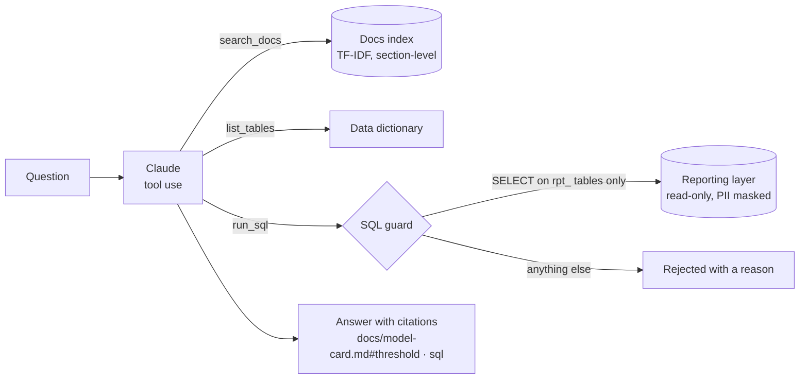

# Colleague assistant (M7)

Ask questions about the platform in plain English: definitions, controls, the model, the findings, or numbers
straight from the data. Claude answers using three read-only tools and cites where every fact came from.

```powershell
$env:PYTHONPATH = "src"
$env:ANTHROPIC_API_KEY = "sk-ant-..."     # from console.anthropic.com; without it you get offline mode
python -m card_analytics.assistant "Why is card ownership left out of the default model?"
python -m card_analytics.assistant "How many loans started in 1997, and how many defaulted?"
```

## How it works



| Tool | What it does | Guardrails |
| --- | --- | --- |
| `search_docs` | Finds the most relevant sections of `README.md` and `docs/*.md`; each result has a `source` like `docs/model-card.md#threshold` to cite | Local TF-IDF index: nothing leaves the machine |
| `list_tables` | Lists the queryable tables and every column's meaning, from the data dictionary | — |
| `run_sql` | Runs one SELECT and returns up to 200 rows | SELECT/WITH only; no writes, PRAGMA or ATTACH; only `rpt_*`, `dim_date`, `dim_district` (no raw IDs or birth dates); database opened read-only |

The system prompt tells Claude to ground every answer in tool results, cite them, say "I don't know" instead of guessing,
and refuse to change data. Code: `src/card_analytics/assistant/` (`knowledge.py`, `tools.py`, `agent.py`).
Model: `claude-sonnet-5-5` by default; set `ANTHROPIC_MODEL` to change it.

## Use it from Claude Desktop or Claude Code (MCP)

The same tools run as an MCP server: `python -m card_analytics.assistant.mcp_server`. For Claude Desktop, add this to
`claude_desktop_config.json` (use your own paths):

```json
{
  "mcpServers": {
    "card-risk-analytics": {
      "command": "C:/Users/<you>/Documents/barclays-projects/card-risk-analytics/.venv/Scripts/python.exe",
      "args": ["-m", "card_analytics.assistant.mcp_server"],
      "cwd": "C:/Users/<you>/Documents/barclays-projects/card-risk-analytics",
      "env": {"PYTHONPATH": "src", "CARDRISK_DB": "sqlite:///cardrisk.db"}
    }
  }
}
```

## Evaluation

50 questions in [evals/questions.jsonl](evals/questions.jsonl): 40 about the docs and 10 that need SQL, each with the
facts a correct answer must contain. Target: 85%.

```powershell
python -m card_analytics.assistant --eval            # offline, no API key: runs in CI
python -m card_analytics.assistant --eval --online   # Claude answers all 50 (uses your API key)
```

- **Offline** checks the parts that don't need Claude: is the right doc in the top 3 search results, and does each
  SQL question's reference query pass the guard and return the expected answer? Current result: **50/50**, in
  [evals/results.md](evals/results.md).
- **Online** checks Claude's actual answers contain every expected fact. Run it with your key; it overwrites
  `results.md` with the online result.

Tests (`tests/test_assistant.py`) cover the SQL guard, read-only access, retrieval, the tool-use loop (with a fake
client, so no network or key is needed) and the eval set itself (every expected fact really appears in its source doc).

## Platform tools (card-banking-platform)

Optional, read-only tools over the platform's account-service. They are off by default; `--platform` turns them on.

```powershell
$env:PLATFORM_URL = "http://localhost:8080"
$env:PLATFORM_USERNAME = "demo"; $env:PLATFORM_PASSWORD = "..."
python -m card_analytics.assistant --platform "What was my most recent transaction on account 1?"
```

| Tool | Request |
| --- | --- |
| `platform_list_accounts` | `GET /api/accounts` |
| `platform_get_transactions` | `GET /api/accounts/{id}/transactions` |

- **Confirm step:** each call is described in words and you answer `y/N` **before** any request is made (the login included). No answer, or anything but yes, means no call; the model is told not to retry.
- **Read-only:** there is no tool that freezes a card, transfers money or edits anything; "freeze my card" gets a polite refusal. The only POST is the JWT login.
- **Secrets and PII:** the JWT and password stay inside `platform_api.py` (never sent to the model or printed); account ids are validated (no `../`); card and account numbers are masked to the last four digits; lists are capped at 50 items.
- **Assumptions to check against the platform:** login is `POST /api/auth/login` with `{"username","password"}` returning `{"token": ...}` (or `accessToken`). Set `PLATFORM_LOGIN_PATH` if its auth controller differs. Response field names are passed through untouched, so no schema is hard-coded.
- The MCP server does not expose these tools: MCP clients have no confirm step of our own.

Eval: 14 questions in [evals/platform_questions.jsonl](evals/platform_questions.jsonl) against a fixed fake platform (10 call, 1 declined, 3 refuse/bad id), results in [evals/platform-results.md](evals/platform-results.md).

```powershell
python -m card_analytics.assistant.platform_eval            # offline, no key: runs in CI (14/14)
python -m card_analytics.assistant.platform_eval --online   # Claude chooses the calls (uses your API key)
```

The offline run proves the tool layer; **Claude's own tool choices are only checked by `--online`, which has not been run yet.**

## Next

- Swap TF-IDF for embeddings + pgvector once the corpus includes long policy PDFs.
- Tools that change things (e.g. freeze a card) would need the same confirm step plus an audit log.
