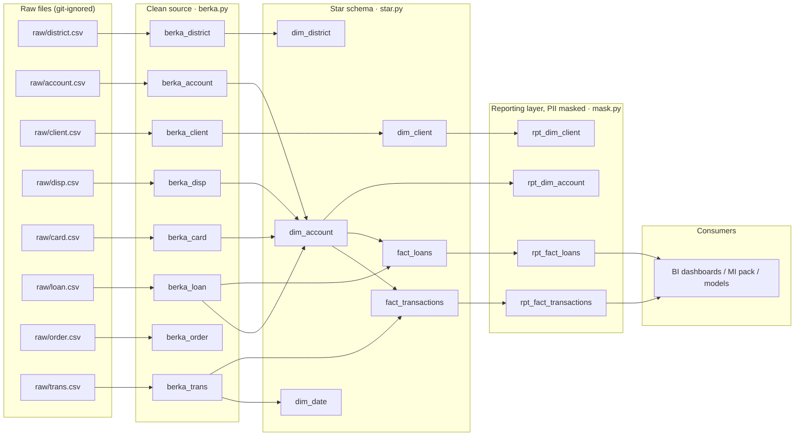

# Lineage

Generated by `python -m card_analytics.catalog`: edges come from the `{{ source() }}` and `{{ ref() }}`
calls in `dbt/models/berka/*.sql`, so this diagram updates itself when a model changes.

Every star-schema table is built from the clean `berka_*` tables, except `dim_date`, which star.py generates
as one row per day across the transaction date range in `berka_trans`.

Controls between layers: integrity checks (berka.py) → model tests + reconciliation (star.py, reconcile.py)
→ masking checks (mask.py). `python -m card_analytics.pipeline` stops at the first failure.

## Edges

| From | To |
| --- | --- |
| raw/district.csv | berka_district |
| raw/account.csv | berka_account |
| raw/client.csv | berka_client |
| raw/disp.csv | berka_disp |
| raw/card.csv | berka_card |
| raw/loan.csv | berka_loan |
| raw/order.csv | berka_order |
| raw/trans.csv | berka_trans |
| berka_trans | dim_date |
| berka_district | dim_district |
| berka_client | dim_client |
| berka_disp | dim_account |
| berka_card | dim_account |
| berka_account | dim_account |
| berka_loan | dim_account |
| berka_trans | fact_transactions |
| dim_account | fact_transactions |
| berka_loan | fact_loans |
| dim_account | fact_loans |
| dim_client | rpt_dim_client |
| dim_account | rpt_dim_account |
| fact_transactions | rpt_fact_transactions |
| fact_loans | rpt_fact_loans |
| rpt_fact_transactions | BI dashboards / MI pack / models |
| rpt_fact_loans | BI dashboards / MI pack / models |
