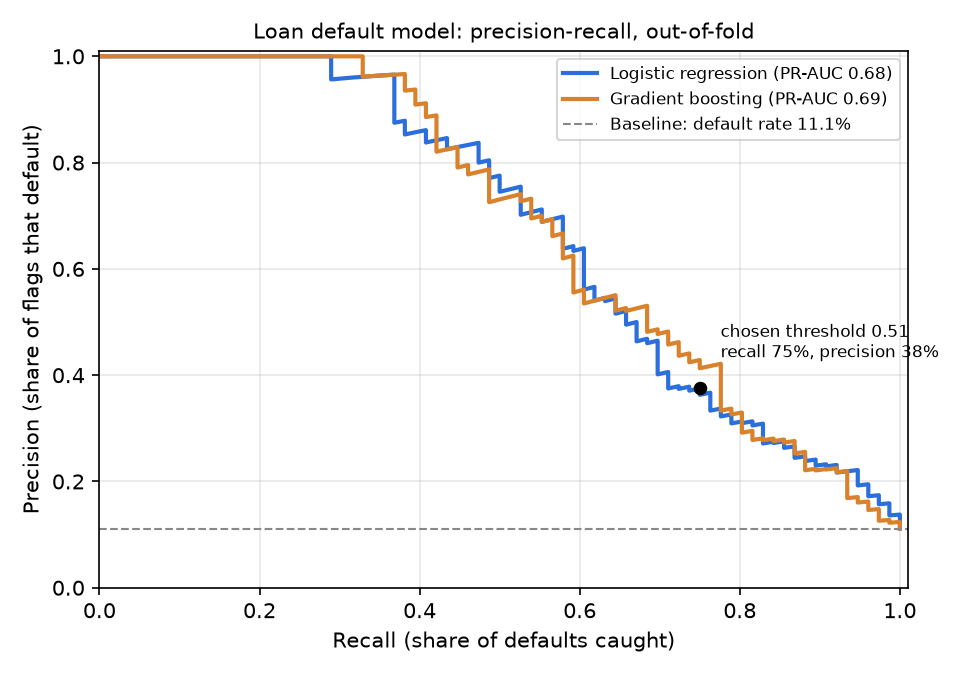

# Model card: loan default model

Generated by `python -m card_analytics.model`.

## What it does

Scores each loan with the probability that it defaults (status `finished_defaulted` or `running_in_debt`),
using only what the bank knew **on the day the loan started**: the loan's terms, the account's transaction
history before that day, and district statistics. Loans above the threshold are flagged for review.

Intended use: prioritising loans for early review by a credit-risk team. **Not** for approving or declining
loans on its own: it was trained on 682 historical loans from one bank in the 1990s.

## Data

- 682 loans, 76 defaults (11.1%). Source: masked reporting layer (`rpt_fact_loans`, `rpt_fact_transactions`).
- Features use transactions **strictly before** the loan start date (tested in `tests/test_model.py`).
- Left out on purpose: card ownership and customer segment. Both are measured at the end of the data, after many
  loans started, so using them would leak the future. (The README's "card holders default less" finding is a
  correlation at the end of the data, not something the model can use at the start of a loan.)

## Models compared

Repeated stratified 5-fold cross-validation (5 × 5 = 25 fits per model). PR-AUC is the headline metric because
defaults are rare: a model that knows nothing scores the default rate (0.11).

| Model | PR-AUC | ROC-AUC |
| --- | ---: | ---: |
| Baseline (always predict the default rate) | 0.111 ± 0.003 | 0.500 ± 0.000 |
| Logistic regression ✓ | 0.685 ± 0.104 | 0.886 ± 0.046 |
| Gradient boosting | 0.693 ± 0.090 | 0.885 ± 0.059 |

Chosen: **Logistic regression**, PR-AUC about 6.2× the baseline. Rule: the simplest model within
0.02 PR-AUC of the best wins, because a bank has to be able to explain a credit model to customers and regulators.

## Threshold

Picked on out-of-fold predictions: the highest precision that still catches at least 75% of defaults.
Missing a default (a loss) costs the bank far more than an extra review, so recall comes first.

At threshold **0.51** the model flags 22% of loans:

| | Flagged | Not flagged |
| --- | ---: | ---: |
| Defaulted | 57 (caught) | 19 (missed) |
| Did not default | 95 (extra reviews) | 511 |

Recall 75%, precision 38%: about 1 in 3 flagged loans defaults,
versus 1 in 9 if loans were reviewed at random.

## What drives the score

Standardised logistic-regression coefficients: the change in log-odds of default for a one-standard-deviation
increase in the feature, holding the others fixed. Positive = raises risk. Income, balance and payment size
move together, so read them as a group: for the same balance and payment, more money flowing through the
account (spent rather than saved) is a warning sign.

| Feature | Coefficient | Effect |
| --- | ---: | --- |
| Average balance before the loan (log) | -1.42 | lowers risk |
| Cash withdrawals, share of money out before the loan | +1.36 | raises risk |
| Average monthly money in before the loan (log) | +1.14 | raises risk |
| Share of pre-loan transactions that left the account overdrawn | +1.05 | raises risk |
| Ever charged penalty (sanction) interest before the loan | +0.60 | raises risk |
| Monthly payment / average monthly money in before the loan | +0.54 | raises risk |
| District average salary, CZK | -0.50 | lowers risk |
| Months of account history before the loan | -0.48 | lowers risk |

## Limitations

- **Small sample.** 682 loans and 76 defaults: the ± ranges above are real uncertainty. Re-validate before any real use.
- **Immature recent loans.** Loans that started in 1998 have had little time to go bad, so their default rate
  is understated (labels are right-censored):

| Start year | Loans | Default rate |
| --- | ---: | ---: |
| 1993 | 20 | 20.0% |
| 1994 | 101 | 13.9% |
| 1995 | 90 | 13.3% |
| 1996 | 117 | 13.7% |
| 1997 | 196 | 13.3% |
| 1998 | 158 | 2.5% |

- **Old, single-bank data** (Czech bank, 1993–1998). Behaviour and economics differ today.
- **Fairness.** No gender or age is used as a feature. District statistics are used and could act as a proxy
  for where people live; check outcomes by district before any real use.
- Scores for every loan are in `rpt_loan_scores` (masked account keys only).
